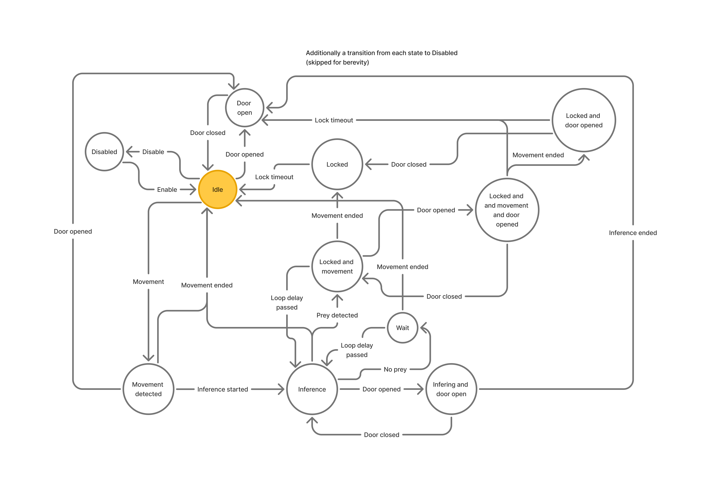
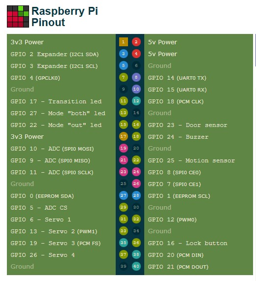

# Cat Flap

Cat Flap is a Raspberry Pi application that coordinates a motorized cat flap, camera-based prey detection, and persistent operating state. The application is split into small Python services. They communicate through a shared ZeroMQ message hub, while the logic service owns the cat-flap state machine and decides when to capture images and engage or release the lock.

## Architecture

The system architecture is split into focused services for logic, image capture, movement detection, hardware input and indication, lock actuation, and persistence. Services can be included in a deployment to match the available hardware and desired capabilities.

### Core state-machine diagram



### Raspberry Pi pinout

The wiring reference below labels the Raspberry Pi GPIO and header pins used by the current hardware setup. Service pin assignments are configurable through the environment variables listed later in this document.



## Message system

Message definitions live in `shared/src/shared/messages.py`; transport is implemented in `shared/src/shared/hub.py`.

### Transport and delivery

- The hub is a ZeroMQ XPUB/XSUB proxy. It binds `message_hub_pub.sock` and `message_hub_sub.sock` under `SOCKETS_DIR` using `ipc://` addresses.
- Workers use PUB to send and SUB to receive. Subscriptions are set to the empty prefix, so every worker receives every published message.
- Each message is serialized as a Python `pickle`. Messages therefore need compatible Python definitions in all participating services, and the hub must only be used by trusted processes. Pickle is not a safe format for untrusted input.
- This is best-effort pub/sub, not a durable queue: messages are not retained for disconnected workers and there are no acknowledgements or retries. The hub does not provide per-message ordering across independent publishers.
- Every `Message` gets a local `datetime.now()` timestamp when constructed. Timestamps are not explicitly timezone-aware.

### Message catalog

| Message | Payload | Meaning and handlers |
| --- | --- | --- |
| `ServiceActivated` | Timestamp only | A worker announces startup. The persistence service responds with the saved state, or an initial state if no valid snapshot exists. |
| `StateUpdate` | `new_state: CatFlapStateMachine` | Logic broadcasts the current state after transitions. `hardware-interface-service` updates its indicator LEDs, `persistence-service` writes a snapshot, and workers receive the startup state from persistence before initialization. |
| `MotionDetectedMessage` | Timestamp only | Movement detector publishes this when its sensor becomes active. Logic starts a capture cycle from idle, or resumes a locked capture cycle. Motion while the door is open is ignored. |
| `MotionEndedMessage` | Timestamp only | Movement detector publishes this when its sensor becomes inactive. Logic ends the movement/capture cycle when the state reports movement active. |
| `DoorOpenedMessage` | Timestamp only | `hardware-interface-service` sends this when the door sensor is pressed; logic updates the state. |
| `DoorClosedMessage` | Timestamp only | `hardware-interface-service` sends this when the door sensor is released; logic updates the state. |
| `MainButtonPressedMessage` | Timestamp only | `hardware-interface-service` sends this on a mode-button press. Logic enables a disabled system or disables an enabled system; the hardware interface also sounds a short confirmation beep. |
| `StartCaptureMessage` | Timestamp only | Logic requests a camera capture. The image-capturer handles it. |
| `ImageCapturedMessage` | `image: PIL.Image.Image` | Image-capturer publishes the captured image. Inference processes it; image-saver saves the raw image; logger records receipt. |
| `InferenceCompleteMessage` | `detected_classes: list[tuple[str, float]]`, `image_with_overlays: numpy.ndarray`, `result_json: str` | Inference publishes detection labels/probabilities, a rendered image, and the model result JSON. Logic decides whether to lock; image-saver writes the rendered image and JSON; logger records receipt. |
| `EngageLockMessage` | Timestamp only | Logic requests lock engagement when entering a locked state. `lock-service` energizes the lock; `hardware-interface-service` sounds an alarm pattern. |
| `DisengageLockMessage` | Timestamp only | Logic requests lock release when leaving a locked state. `lock-service` de-energizes the lock. |

All message types inherit the timestamp field from `Message`. Large image fields are sent inline through the same pickle transport, rather than via a separate blob store.

## Execution flows

### Service startup and state restoration

1. `hub-service` binds the two IPC sockets and proxies traffic between publishers and subscribers.
2. A normal worker connects, publishes `ServiceActivated`, and waits for a `StateUpdate` before starting its message handler. The persistence worker uses a separate startup path and waits briefly before connecting.
3. On `ServiceActivated`, persistence reads `/data/state.json`. It publishes the restored state, or a new default `CatFlapStateMachine` if the file is absent or invalid.
4. Logic configures the capture and lock timers, registers state listeners, and restarts timers for states that need them. If startup restores an active movement or inference state, logic resumes the capture process.
5. On each later state transition, logic publishes `StateUpdate`. Persistence writes the current state ID (or active state IDs) to `/data/state.json`; the hardware interface refreshes its indicators. On startup, `lock-service` energizes the electromagnet if the restored state is locked.

The saved snapshot contains state identifiers rather than the whole machine. State transitions and timer behavior are defined in `shared/src/shared/state.py`.

### Movement, capture, and inference

1. In `idle`, `MotionDetectedMessage` moves the machine to `movement_detected`, then logic immediately starts inference. The state listener publishes `StartCaptureMessage` when inference begins.
2. Image-capturer handles `StartCaptureMessage`, takes a camera image, and publishes `ImageCapturedMessage`.
3. Inference handles `ImageCapturedMessage`, runs the YOLO model, and publishes `InferenceCompleteMessage` with class names, confidence values, an overlay image, and JSON results.
4. Logic accepts inference results only while inference is active. It finds the highest-confidence `prey` result and compares it with `PREY_PROBABILITY_REQUIRED_FOR_LOCKOUT` (default `0.5`).
5. If prey probability is strictly greater than the threshold, logic enters a locked state and publishes `EngageLockMessage`. Otherwise it enters a wait state without locking.
6. After `CAPTURE_INTERVAL` (default `2s`), logic requests another capture while the relevant movement/wait state remains active. A `MotionEndedMessage` ends the cycle when accepted by the current state.
7. Regardless of the lock decision, image-saver saves each raw capture and each completed inference image/result. The logger records these image events.

### Lock and timeout

When a prey result qualifies, `MessageSenderListener` compares the new state with whether it believes the lock is engaged and publishes the corresponding lock command. `lock-service` actuates the electromagnet; `hardware-interface-service` sounds the alarm when it receives the engage command. `LOCKOUT_DURATION` (default `20s`) controls the locked-state timeout; after timeout the state machine can return to idle, or to the door-open state if the door remains open. A movement event while locked starts periodic captures during the lockout.

### Door and mode button

- Door sensor press/release on `hardware-interface-service` publishes `DoorOpenedMessage` / `DoorClosedMessage`. Logic tracks the door alongside movement, inference, and lock states. Motion events received while the door is open are ignored.
- Pressing the mode button publishes `MainButtonPressedMessage`. Logic toggles between disabled and enabled (idle). The hardware interface sounds a short beep on each button event, and state updates drive the active indicator.
- Disabling transitions the state machine to `disabled` from any defined operating state. It does not itself publish a lock-release command unless the machine's locked-state value changes in a way that triggers the listener.

### Image saving

`image-saver-service` creates these directories and saves messages independently of logic decisions:

| Directory | Contents |
| --- | --- |
| `/data/captured` | Raw camera images, named with the message timestamp. |
| `/data/labeled` | Inference images with overlays. |
| `/data/results` | Inference result JSON. |

## Services

| Service | Responsibility |
| --- | --- |
| `hub-service` | Runs the ZeroMQ message proxy. |
| `logic-service` | Owns the state machine, interprets events and inference results, schedules repeated captures, and requests lock actions. |
| `movement-detector-service` | Reads the movement sensor and publishes movement-started and movement-ended events. |
| `hardware-interface-service` | Reads the door and mode-button inputs; controls the buzzer and indicator LEDs. |
| `lock-service` | Controls the lock electromagnet and restores its output from the initial state. |
| `image-capturer-service` | Captures still images using Picamera2. |
| `inference-service` | Warms up and runs the YOLO model; publishes detections and rendered results. |
| `image-saver-service` | Persists raw images, rendered images, and model-result JSON. |
| `persistence-service` | Restores and saves the state-machine snapshot. |
| `logger-service` | Logs received messages for operational visibility. |
| `shared` | Defines messages, state-machine behavior, the hub clients, and shared worker startup. |

## Configuration and runtime data

The services are intended to run as separate Docker containers on the Raspberry Pi. The hub and every worker must use the same `SOCKETS_DIR` path and mount the same Docker named volume there. ZeroMQ creates Unix-domain IPC socket files inside that directory; all participating containers need to see those same files. The root `Dockerfile` sets `SOCKETS_DIR` to `/var/run/cat-flap/sockets`.

### Shared container settings

| Variable | Applies to | Default / requirement |
| --- | --- | --- |
| `SOCKETS_DIR` | Hub and all workers | Required; use the same path in each container. Root `Dockerfile` sets `/var/run/cat-flap/sockets`. |
| `LOG_FOLDER` | All services using shared logging | `/var/log/cat-flap`. |
| `LOG_FILE_NAME` | All services using shared logging | Service logger name. |
| `LOG_LEVEL` | All services using shared logging | `INFO`. |

### Per-service environment variables

#### `hub-service`

No service-specific variables. Requires the shared `SOCKETS_DIR` setting.

#### `logic-service`

| Variable | Default | Description |
| --- | --- | --- |
| `CAPTURE_INTERVAL` | `2s` | Delay between repeated capture cycles. |
| `LOCKOUT_DURATION` | `20s` | Duration of a locked state. |
| `PREY_PROBABILITY_REQUIRED_FOR_LOCKOUT` | `0.5` | Prey confidence must be strictly greater than this value to lock. |

#### `movement-detector-service`

| Variable | Default | Description |
| --- | --- | --- |
| `MOTION_SENSOR_PIN` | `25` | Raspberry Pi GPIO pin for the movement sensor. |
| `PIGPIO_ADDR` | `localhost` | Pigpio daemon host; the service Dockerfile sets this default. |
| `PIGPIO_PORT` | `8888` | Pigpio daemon port; the service Dockerfile sets this default. |

#### `hardware-interface-service`

| Variable | Default | Description |
| --- | --- | --- |
| `PIGPIO_ADDR` | `localhost` | Pigpio daemon host. |
| `PIGPIO_PORT` | `8888` | Pigpio daemon port. |
| `I2C_BUS_NUMBER` | `1` | I2C bus used by the GPIO expander. |
| `I2C_EXPANDER_ADDRESS` | `0x20` | GPIO expander address, parsed as hexadecimal. |
| `ACTIVE_DIODE_EXPANDER_PIN` | Required | GPIO expander pin for the active indicator. |
| `MOTION_DETECTED_DIODE_EXPANDER_PIN` | Required | GPIO expander pin for the movement indicator. |
| `LOCKED_DIODE_EXPANDER_PIN` | Required | GPIO expander pin for the locked indicator. |
| `DOOR_OPEN_DIODE_EXPANDER_PIN` | Required | GPIO expander pin for the open-door indicator. |
| `INFERENCE_DIODE_EXPANDER_PIN` | Required | GPIO expander pin for the inference indicator. |
| `DOOR_SENSOR_PIN` | Required | Raspberry Pi GPIO pin for the door sensor. |
| `BUZZER_PIN` | Required | Raspberry Pi GPIO pin for the buzzer. |
| `MODE_BUTTON_PIN` | Required | Raspberry Pi GPIO pin for the mode button. |

#### `lock-service`

| Variable | Default | Description |
| --- | --- | --- |
| `PIGPIO_ADDR` | `localhost` | Pigpio daemon host. |
| `PIGPIO_PORT` | `8888` | Pigpio daemon port. |
| `LOCK_PIN` | Required | Raspberry Pi GPIO pin controlling the lock electromagnet. |

#### `image-capturer-service`

| Variable | Default | Description |
| --- | --- | --- |
| `CAMERA_RESOLUTION_WIDTH` | `1920` | Captured image width in pixels. |
| `CAMERA_RESOLUTION_HEIGHT` | `1080` | Captured image height in pixels. |

#### `inference-service`

No service-specific environment variables. The runtime must provide the `weights_ncnn_model` model directory.

#### `image-saver-service`

No service-specific environment variables. It writes under `/data/captured`, `/data/labeled`, and `/data/results`.

#### `persistence-service`

No service-specific environment variables. It reads and writes `/data/state.json`.

#### `logger-service`

No service-specific environment variables beyond the shared logging settings.

Persistent/runtime files are `/data/state.json`, `/data/captured`, `/data/labeled`, and `/data/results`. Mount persistent storage at `/data` for the persistence and image-saver containers.

## Docker deployment

The stack is intended to run as one container per service on the Raspberry Pi. The sample Compose file belongs in this section; ensure every service, including `hub-service`, mounts the same named volume at the same `SOCKETS_DIR` path.

```yaml
# Sample full-stack docker-compose.yml goes here.
# Include hub-service, logic-service, movement-detector-service,
# misc-hardware-service, image-capturer-service, inference-service,
# image-saver-service, persistence-service, and logger-service.
# Mount one shared named volume at /var/run/cat-flap/sockets in every service.
# Mount persistent /data storage in persistence-service and image-saver-service.
```

Persistent/runtime files are `/data/state.json`, `/data/captured`, `/data/labeled`, and `/data/results`. Inference loads `weights_ncnn_model`; the runtime image provides the model weight.

## Development

The repository is a `uv` workspace. It includes a focused logic-service test suite (`logic-service/test_main.py`) and state-machine tests (`shared/src/shared/test_state.py`). Run the tests from the repository root with:

```sh
uv run pytest logic-service/test_main.py shared/src/shared/test_state.py
```

Hardware-facing services require Raspberry Pi camera/GPIO/I2C dependencies and hardware access, so they are not exercised by these logic/state tests.